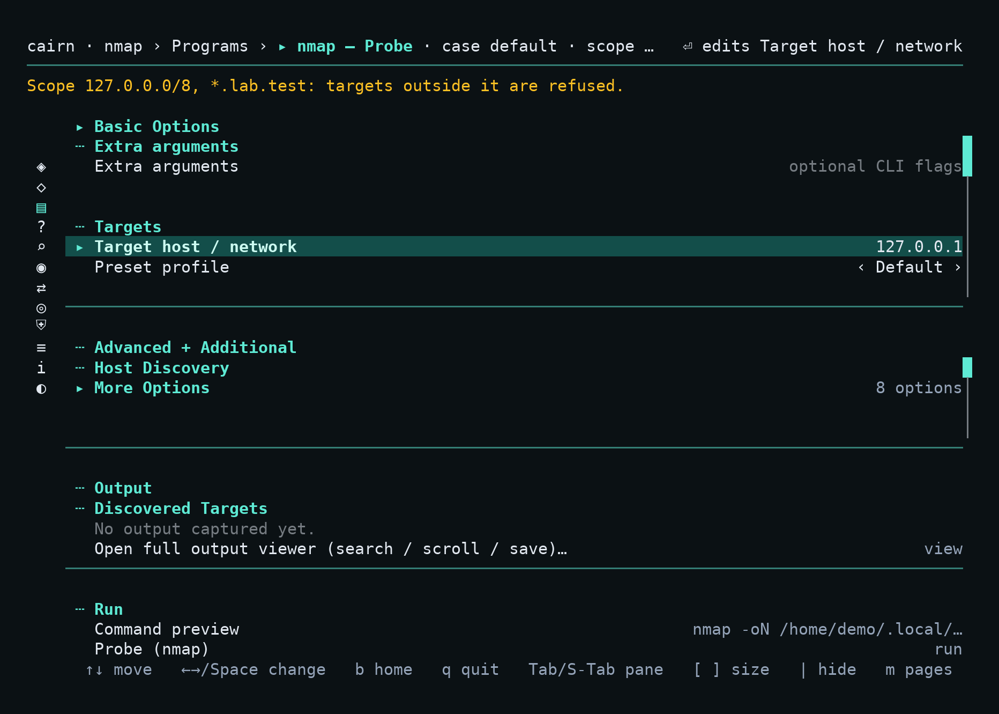
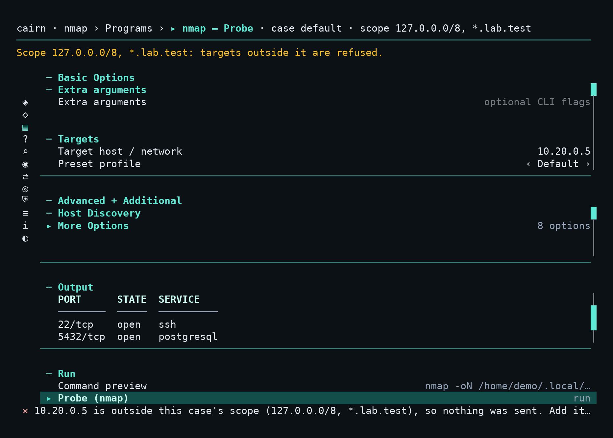

# cairn

A terminal workbench for security work. Keep a **case**, say what you are **allowed to test**, run the everyday tools from one place, and **send what one finds to the next**, so you stop retyping targets and hopping between windows.

**Install:** `curl -fsSL https://raw.githubusercontent.com/CurtisD4q/cairn/main/install.sh | sh` (Linux and macOS; [more ways below](#install)).

Built with [pmin](https://github.com/CurtisD4q/pmin): the screens are pmin-kit, with its own look and layout. It runs in a modern terminal and inside Emacs.

## Screenshots

These show the current `main` branch, using a demo case and test services on the machine itself. The latest release may look different.

| | |
|---|---|
|  |  |
| **Run a tool.** Its options in plain words, the exact command, and what came back as a table. | **Send it on.** Pass a result to another tool, the logs, the machines list or the case. |
|  |  |
| **What's wrong.** Start from what you notice. Here, what others can reach; there was no system journal, so the log check could not tell. | **Threats.** A chain of filters, one step at a time, with the command it makes. |
|  |  |
| **Programs.** Open a program by name, or choose from drop-down groups. | **A program inside cairn.** nmap's options, target, output and Run, with the case's scope above. |
|  |  |
| **Refused in Programs.** An address outside the scope is refused before nmap starts. | **Audit log.** Runs, refusals and checks, each with its time and result. |

## What it does

- **One case, one target.** Type a target once. Every tool starts with it, in the form that tool needs (an address for `ping`, a web address for `curl`).
- **Scope first.** List the networks, addresses and domains you may test. Before Port scan, Trace the route, Is it up? or Web headers runs, cairn checks the typed target against that list and asks you to confirm. No scope set: it asks first. Outside it: you must type the target to go ahead, and the override is recorded. Name records and Who owns it are look-ups and are not scope-checked. [Programs](#programs) is stricter: it refuses. Read [Known limits](#known-limits) before relying on either.
- **Send results on.** Select a row in a result (an open port, an IP in a trace, a name server) and open it in another tool, hunt for it in the logs, save it as a machine, add it to the case, or copy it.
- **Look for signs of intrusion.** *What's wrong* starts from what you notice ("I think someone got in", "What can others reach here?") and runs read-only checks: failed logins, accounts with root's power, login keys changed lately, administrator commands, what is open to every network.
- **Threats.** Ready-made hunts (failed logins by address, who logged in, administrator commands) narrow the logs down step by step, showing what each step keeps and the command it makes.
- **Keep the machines.** Save machines from results, check their host keys, connect with ssh, open tunnels.
- **Hardening.** Accounts, permissions, the firewall and ssh settings, read-only until you choose Apply; a change that could cut off your own connection is refused or put back on its own unless you confirm you can still get in.
- **Programs, in the Mint layout.** *Programs* opens a command-line program inside cairn: its options, the exact command, Run and what came back, in panes. For programs that reach other machines, the targets cairn recognises in a command are checked against the case's scope.
- **Plain words, exact command.** Tools explain their choices and show the command, so you can see and learn what is being run.
- **One audit log and a report.** Runs, checks, changes and refusals go in the case's log with the time, the command and, where there is one, the target and scope result. Some runs can be missed (see [Known limits](#known-limits)). Save the case as a Markdown report.

## Built with pmin

cairn is a program built with pmin (tier `example` in `pmin.json`). It uses the pmin foundation, four function modules and two engines, and no other program:

| Part of cairn | Module | What cairn adds |
|---|---|---|
| What's wrong, Health | pmin-lookout | Five security checks and two symptoms, as data |
| Threats | pmin-conduit | The ssh and sudo logs as sources, a "Pick out addresses" step, and three ready-made hunts |
| Machines, Keys | pmin-bridge | Saving a result as a machine, checked against the case's scope |
| Hardening | pmin-warden | Its lockout guard, served by cairn itself |
| Programs | pmin-wrap | Any program in the Mint layout, held to the case's scope |

The modules never import an engine, so cairn plugs them in itself (`plug` in `internal/ui/packs.go`): Warden reads and changes the firewall with pmin-netfilter, and Bridge opens serial consoles with pmin-serial.

The modules write into the open case's audit log. The screens come from pmin-kit; the checks, values, wording and scope rules from pmin-base and pmin-tools.

## Tools in this version

| Tool | Program | For |
|---|---|---|
| Port scan | `nmap` | which ports are open, and what is behind them |
| Trace the route | `traceroute` | the path to a host |
| Is it up? | `ping` | whether a host answers, and how fast |
| Web headers | `curl` | what a web server says about itself, redirects, HSTS |
| Name records | `dig` | A, AAAA, MX, NS, TXT, CNAME, SOA, and reverse lookups |
| Who owns it | `whois` | registrar, dates, name servers, network owner |
| Open ports here | `ss` | what this computer is listening on |

Tools that are not installed are listed as such; opening one shows the package name for Debian and Ubuntu.

The tools, checks and log hunts are written for Linux. There are macOS builds, but `ss` and `journalctl` are Linux programs, the login-key check needs GNU `find`, and the output parsers are tested against Linux output, so expect parts not to work on macOS.

## Programs

*Programs* opens command-line programs inside cairn, in the Mint layout: options in panes, the exact command, Run, and what came back, the way pmin-wrap shows it, in cairn's own frame.


- **Open a program…** takes any program's name. It is checked in the background first: programs that draw their own screen (vim, less), parts of the shell (cd) and programs with windows are not opened, and you are told why. Programs opened this way are kept in the list (in `programs/` beside the cases).
- The list also shows the programs mint-wr keeps (its *Your programs*) and the standalone copies it makes (`mint-wr --make nmap` puts `nmap-mint` in `~/.local/bin`), in drop-down groups by what they do. Choose one, then the screen it starts at.
- **Scope.** For a program that reaches other machines (nmap, curl, ssh, rsync, dig… and anything in the *Act on targets* group), cairn looks through each command for addresses, networks, names and web addresses. If one it recognises is outside the case's scope, the command is refused and does not start. With no scope set, commands naming a recognised target are refused. A command in which cairn recognises no target is **allowed** (see [Known limits](#known-limits)).
- **Audit log.** Commands run from inside these screens, and refusals, go in the case's audit log.
- Settings typed into a program stay while cairn runs, so it opens as you left it; secrets typed into one are wiped when cairn closes.

cairn looks for Mint programs in `~/.local/bin/mint-interfaces`, `~/.local/bin`, `/usr/local/bin` and, when `MINT_INTERFACES_DIR` is set, that checkout's `apps` folder; set `MINT_APP_DIRS` to a `:`-separated list of folders to look there instead. Only executable files whose names end in `-mint` are asked what they are. An app built with `mint-g --build` carries no description cairn can read, so it opens on its own. cairn does not check its targets or see what it runs; it logs only that the app was opened, as *handed over (not checked)*.

## Install

One command downloads the latest release, checks it against its checksum and installs it:

```
curl -fsSL https://raw.githubusercontent.com/CurtisD4q/cairn/main/install.sh | sh
```

The command installs the latest release, which can be older than `main` and this README.

That is the whole job: no Go, no source checkout and no access to any other repository is needed. `cairn` goes into `~/.local/bin`, with `cairn.el` for Emacs beside its data. If that folder is not on your PATH, the installer prints the line to add. After that, run `cairn` from anywhere. To install for everyone in `/usr/local` instead, add `-s -- --system` after `sh`.

Or by hand: download the archive for your machine from Releases, check it against `SHA256SUMS`, unpack it and run `./cairn install`. The download can be deleted afterwards.

To remove it: `cairn uninstall`. Your settings and data are kept.

### Build from source

Most people do not need this; the install command above is enough. Building needs Go and access to the private pmin libraries, which are not public:

```
git clone https://github.com/CurtisD4q/cairn
cd cairn
export GOPRIVATE='github.com/CurtisD4q/*'
make install        # builds, then installs into ~/.local/bin
```

After `make install` the cloned folder can be deleted. To clone and fetch the libraries over SSH instead of HTTPS, tell git once: `git config --global url."git@github.com:".insteadOf "https://github.com/"`, and clone `git@github.com:CurtisD4q/cairn.git`.

## Using it

cairn opens on a menu of its pages: Workbench, Case, Programs, What's wrong, Threats, Health, Machines, Keys, Hardening, Audit log, Guide and Theme. Open **Case** and add your scope, for example `10.0.0.0/24` or `example.com` (a domain covers its subdomains; `*.lab.test` covers only the subdomains). On the **Workbench**, type a target, pick a tool, and choose **Run**. In the results, select a row to send it on. **Guide** in the app is a one-page guide.


Keys: arrows move, Enter opens or changes, Tab (or `1`–`3` on many screens) moves between panes, `/` filters a list, `m` opens the list of pages (Enter opens one), `?` lists every key, `b` goes back, `q` quits; the mouse works. A scope-checked tool asks before it runs, showing the exact command. `MINT_KEYS=emacs` or `vim` adds those key styles. Colours follow the Mint theme screen, or `MINT_PALETTE`.

## In Emacs

`emacs/cairn.el` adds `M-x cairn`. If `mint.el` (part of pmin-kit, which is private) is installed, cairn is started with it (handover in terminal Emacs, Emacs keys, your theme's colours). Otherwise it runs in a `term` buffer. `M-x cairn-cases` opens the folder of cases and saved reports in Dired.

The installer puts `cairn.el` in cairn's data folder. Load it from your init file:

```elisp
(load "~/.local/share/cairn/cairn.el")
```

After a `--system` install the file is `/usr/local/share/cairn/cairn.el`. The installer prints the right line.

## Where things are kept

Cases, audit logs and reports are in `~/.local/share/cairn/cases/` (or `$CAIRN_HOME/cases/`). cairn creates the folder as `0700` and its files as `0600`. Programs you open by name are listed in `programs/` beside it. Output that a program screen saves to a file is kept separately, in that program's results folder (shown in its command preview or on its screen); cairn does not restrict those files' permissions. cairn sends nothing anywhere itself; the tools talk to the targets you point them at, and `dig` and `whois` ask public servers.

## Safety, and what it does not do

- The seven built-in tools run directly, never through a shell. Their targets are checked, and anything that could be taken for an option (a leading `-`) is refused. `nmap`, `traceroute`, `ping` and `whois` get the target after `--`, `curl` gets it after `--url`, and `dig` gets it as a plain argument.
- The scope check judges text only. It does not resolve names, so a domain cannot be matched against an address range; use the address, or add the domain.
- cairn helps you stay within your permission. It does not give you any. Only test what you are authorised to test.

## Known limits

The scope check and the log are aids, not a barrier or a complete record.

- **Redirects.** With *Follow redirects* on, Web headers checks only the address you typed. A redirect can send requests to a host outside the scope, and the log names only the typed target. Leave it off unless every possible destination is in scope.
- **Unrecognised targets in Programs.** A command is allowed when cairn finds no target in it, even with no scope set, and a recognised target does not mean every destination was found. Examples that get past the check: a target list in a file whose name does not look like a host (`nmap -iL /tmp/targets`), wildcards such as `192.168.1.*`, comma lists such as `10.0.0.5,9`, an address written as one number, and a proxy joined to its option (`curl -xhttp://…`). Programs that cairn does not treat as reaching other machines are not checked at all.
- **A false all-clear.** *What's wrong* may report no failed logins, administrator commands or changed login keys when your account cannot read the logs or the files. An empty or unreadable journal can look the same. Treat "fine" as meaningful only if you know cairn could read them.
- **Missing log entries.** A Workbench run is logged when its screen sees it finish. If you go back, switch pages or quit while it is running, it is not logged.
- **Secrets.** A password or key that a program takes on its command line may be saved in plain text in the audit log, and so in reports. Check both before sharing them.
- **IPv6.** *Pick out addresses* finds IPv4 addresses only, so the failed-logins and who-logged-in hunts leave IPv6 addresses out.

## Not tested here

ufw, systemd actions and a live ssh server were not available on the machine cairn was built on, so those paths are tested against saved output only. Each pack's README says the same for its part.

## Accessibility: where it stands

Built in: every option explained in plain words, the exact command always on screen, state always written out (never colour alone), consistent screens, keyboard and mouse, Emacs and vim key styles, and fallbacks for terminals without colour or Unicode.

Not yet done: it has **not been tested with a screen reader or braille display**, and has **not been tested with people who have learning disabilities**. A full-screen terminal interface that redraws in place is hard for screen readers; a plain, append-only mode is the planned answer. Treat the above as groundwork, not a claim.

## Development

```
go work init . ../pmin-kit   # to build against a local checkout; go.work is git-ignored
go vet ./... && go test ./...
emacs --batch -L emacs -l emacs/cairn-tests.el -f ert-run-tests-batch-and-exit
```

Tests include live runs of `ss`, `curl`, `ping`, `traceroute` and `nmap` against this computer only; they skip any program that is not installed.

## Licence

Apache-2.0, as pmin-kit.
