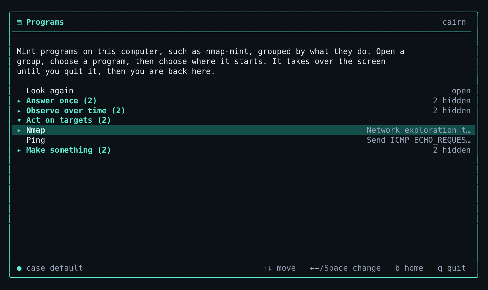
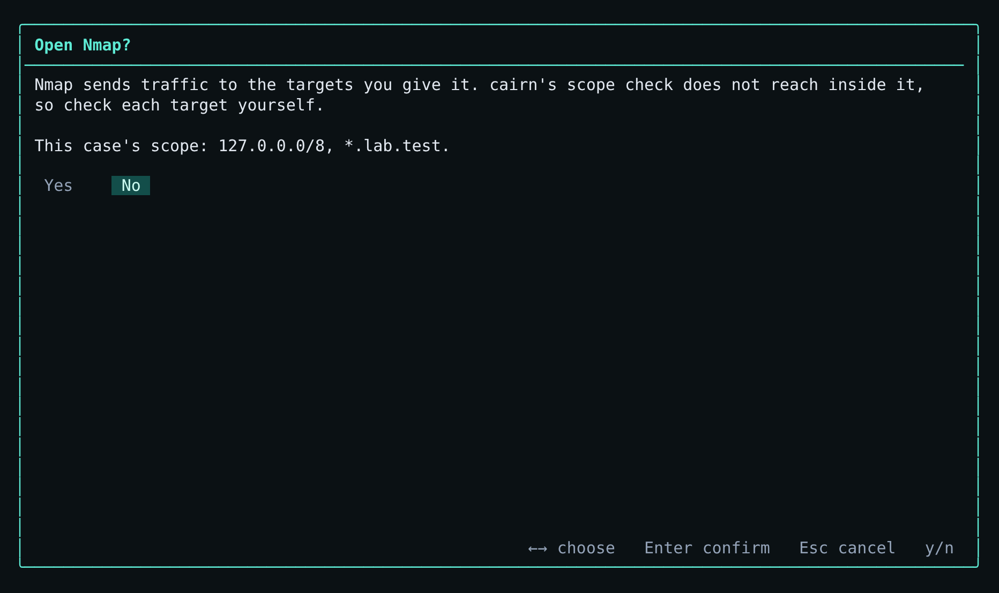

# cairn

A terminal workbench for security work. Keep a **case**, say what you are **allowed to test**, run the everyday tools from one place, and **send what one finds to the next**, so you stop retyping targets and hopping between windows.

Built on [mint-kit](https://github.com/CurtisD4q/mint-kit) (the terminal UI library), with its own look and layout. It runs in any modern terminal and inside Emacs.


## Screenshots

| | |
|---|---|
|  |  |
| **Run a tool.** Its options in plain words, the exact command, and what came back as a table. | **Send it on.** Anything a tool finds goes straight into the next tool, the logs, the machines list or the case. |
|  |  |
| **Something's wrong.** Start from what you notice; read-only checks list what they found, problems first. | **Hunt in the logs.** A chain of filters, one step at a time, with the exact command it makes. |
|  |  |
| **Programs.** Every Mint program on this computer (nmap-mint and the like), in drop-down groups. | **Scope first.** Programs that send traffic show the case's scope and ask before they open. |

## What it does

- **One case, one target.** Type a target once. Every tool starts with it, in the form that tool needs (an address for `ping`, a web address for `curl`).
- **Scope first.** List the networks, addresses and domains you may test. Before any tool that sends traffic runs, cairn checks the target against that list. No scope set: it asks. Outside it: you must type the target out to go ahead, and the override is recorded.
- **Send results on.** Select a row in a result (an open port, an IP in a trace, a name server) and open it in another tool, hunt for it in the logs, save it as a machine, add it to the case, or copy it.
- **Look for signs of intrusion.** *Something's wrong* starts from what you notice ("I think someone got in", "What can others reach here?") and runs read-only checks: failed logins, accounts with root's power, login keys changed lately, administrator commands, what is open to every network.
- **Hunt in the logs.** Ready-made hunts (failed logins by address, who logged in, administrator commands) narrow the logs down step by step, showing what each step keeps and the command it makes.
- **Keep the machines.** Save machines from results, check their host keys, connect with ssh, open tunnels.
- **Harden this machine.** Accounts, permissions, the firewall and ssh settings, read-only until you choose Apply; a change that could cut off your own connection is refused or put back on its own unless you confirm you can still get in.
- **Open your other Mint programs.** *Programs* lists every Mint program on this computer (such as `nmap-mint`, made by [mint-wrapper](https://github.com/CurtisD4q/mint-wrapper)), in drop-down groups by what it does (Answer once, Observe over time, Act on targets…). Choose a program, then where it starts; it takes over the screen and you are back in cairn when you quit it.
- **Plain words, exact command.** Everything explains itself, and the exact command is always shown, so you can see and learn what is being run.
- **One audit log and a report.** Everything done in the case, by every part of cairn, is logged with its time, target and whether it was in scope or agreed to. Save the case as a Markdown report.

## Built from the Mint packs

cairn is the cybersecurity program built from [mint-kit](https://github.com/CurtisD4q/mint-kit) and [mint-tools](https://github.com/CurtisD4q/mint-tools), with four packs as siblings:

| Part of cairn | Pack | What cairn adds |
|---|---|---|
| Something's wrong, Health | [mint-lookout](https://github.com/CurtisD4q/mint-lookout) | Five security checks and two symptoms, as data |
| Hunt in the logs | [mint-conduit](https://github.com/CurtisD4q/mint-conduit) | The ssh and sudo logs as sources, a "Pick out addresses" step, and three ready-made hunts |
| Machines, Your keys | [mint-bridge](https://github.com/CurtisD4q/mint-bridge) | Saving a result as a machine, checked against the case's scope |
| Harden this machine | [mint-warden](https://github.com/CurtisD4q/mint-warden) | Its lockout guard, served by cairn itself |

Every pack writes into the open case's audit log. The checks, values and scope rules come from mint-tools.

## Tools in this version

| Tool | Program | For |
|---|---|---|
| Port scan | `nmap` | which ports are open, and what is behind them |
| Trace the route | `traceroute` | the path to a host |
| Is it up? | `ping` | whether a host answers, and how fast |
| Web headers | `curl` | what a web server says about itself, redirects, HSTS |
| Name records | `dig` | A, AAAA, MX, NS, TXT, CNAME, SOA, and reverse lookups |
| Who owns it | `whois` | registrar, dates, name servers, network owner |
| Open ports here | `ss` | what this computer is listening on |

Tools that are not installed are listed as such, with the package name for Debian and Ubuntu.

## Programs

The *Programs* page finds Mint programs such as `nmap-mint`: `mint-wrapper --make nmap` makes one in `~/.local/bin` without compiling anything (see [mint-wrapper](https://github.com/CurtisD4q/mint-wrapper)). It looks in `~/.local/bin/mint-interfaces`, `~/.local/bin`, `/usr/local/bin` and, when `MINT_INTERFACES_DIR` is set, that checkout's `apps` folder (one level of subfolders too). Set `MINT_APP_DIRS` to a `:`-separated list of folders to look there instead.

Only executable files whose names end in `-mint` are asked what they are (`<program> --mint-info`, three seconds each); nothing else is run. Each program reports its group, and the groups start folded: open one, choose a program, then choose *Open* or one of its screens to start at.

Opening a program is written to the case's audit log as *handed over (not checked)*: cairn's scope check does not reach inside another program. Programs in the *Act on targets* group show the case's scope and ask before they open.

## Install

cairn needs Go 1.21 or newer. It depends on mint-kit, mint-tools and four packs, which are private repositories, so tell Go to fetch them directly:

```
git clone https://github.com/CurtisD4q/cairn
cd cairn
export GOPRIVATE='github.com/CurtisD4q/*'
go mod tidy          # first time only: fetches the libraries and writes go.sum
go build -o cairn ./cmd/cairn
./cairn
```

Git must be able to read those repositories (an SSH key or `gh auth login`). Put the binary anywhere on your `PATH`.

## Using it

Open **Case** and add your scope, for example `10.0.0.0/24` or `example.com` (a domain covers its subdomains; `*.lab.test` covers only the subdomains). On the **Workbench**, type a target, pick a tool, and choose **Run**. In the results, select a row to send it on. **How this works** in the app is a one-page guide.

Keys: arrows move, Enter opens or changes, Tab moves between panes, `b` goes back, `q` quits; the mouse works. `MINT_KEYS=emacs` or `vim` adds those key styles. Colours follow the Mint theme screen, or `MINT_PALETTE`.

## In Emacs

`emacs/cairn.el` adds `M-x cairn`. If [mint.el](https://github.com/CurtisD4q/mint-interfaces/tree/main/emacs) is installed, cairn is started with it (handover in terminal Emacs, Emacs keys, your theme's colours). Otherwise it runs in a `term` buffer. `M-x cairn-cases` opens the folder of cases and saved reports in Dired.

```elisp
(add-to-list 'load-path "/path/to/cairn/emacs")
(require 'cairn)
```

## Where things are kept

Cases, audit logs and reports are in `~/.local/share/cairn/cases/` (or `$CAIRN_HOME`), private to you (folders `0700`, files `0600`). cairn sends nothing anywhere itself; the tools talk to the targets you point them at, and `dig` and `whois` ask public servers.

## Safety, and what it does not do

- Programs are run directly, never through a shell. Targets are checked, and anything that could be taken for an option (a leading `-`) is refused; every command puts the target after `--`.
- The scope check judges text only. It does not resolve names, so a domain cannot be matched against an address range; use the address, or add the domain.
- cairn helps you stay within your permission. It does not give you any. Only test what you are authorised to test.

## Not tested here

ufw, systemd actions and a live ssh server were not available on the machine cairn was built on, so those paths are tested against saved output only. Each pack's README says the same for its part.

## Accessibility: where it stands

Built in: every option explained in plain words, the exact command always on screen, state always written out (never colour alone), consistent screens, keyboard and mouse, Emacs and vim key styles, and fallbacks for terminals without colour or Unicode.

Not yet done: it has **not been tested with a screen reader or braille display**, and has **not been tested with people who have learning disabilities**. A full-screen terminal interface that redraws in place is hard for screen readers; a plain, append-only mode is the planned answer. Treat the above as groundwork, not a claim.

## Development

```
go work init . ../mint-kit   # to build against a local checkout; go.work is git-ignored
go vet ./... && go test ./...
emacs --batch -L emacs -l emacs/cairn-tests.el -f ert-run-tests-batch-and-exit
```

Tests include live runs of `ss`, `curl`, `ping`, `traceroute` and `nmap` against this computer only; they skip any program that is not installed.

## Licence

Apache-2.0, as mint-kit.
